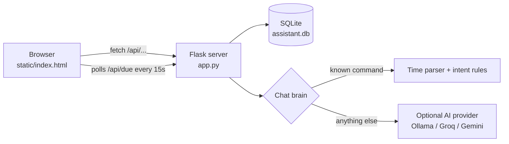

<div align="center">

# ✨ Nova

### Your AI-powered personal assistant

Manage tasks, meetings and reminders from one calm dashboard, or just tell Nova what you need in plain English.


[Features](#-features) · [Quick start](#-quick-start) · [AI chat setup](#-enable-ai-chat-optional) · [Commands](#-chat-commands) · [API](#-api-reference) · [Troubleshooting](#-troubleshooting) · [Roadmap](#-roadmap)

</div>

<!-- Tip: add a screenshot at docs/screenshot.png and uncomment the next line

-->

---

## 🌿 About

**Nova** is a personal assistant that runs entirely on your own laptop. A Python (Flask) backend stores your data in a local SQLite database, and a clean single-page web app gives you a dashboard plus a chat box that understands everyday language, like *"remind me to call mom at 6pm"*.

The core assistant works **with no internet and no API key**. If you want open-ended conversation, you can plug in a free AI provider (Ollama, Groq, Gemini and others) by editing one config file.

## 🎯 Features

| | Feature | What it does |
|---|---|---|
| ✅ | **Task manager** | Add tasks with priority (high, medium, low) and a due date. Tick them off and delete them. |
| 📊 | **To-do chart** | A live completion ring and priority bars show your progress at a glance. |
| 📅 | **Meeting scheduler** | Schedule meetings with a start and end time. Overlaps are detected and blocked automatically. |
| ⏰ | **Reminders** | Set a time and get an on-screen pop-up plus an optional browser notification when it is due. |
| 💬 | **Natural-language chat** | Create tasks, reminders and meetings by typing normal sentences. Understands "tomorrow", "in 30 minutes", "friday", "at 5pm". |
| 🤖 | **AI conversation (optional)** | Anything Nova does not recognise as a command is sent to an AI model of your choice. |
| 🔒 | **Private by default** | All data stays in a local file on your machine. Nothing is uploaded. |
| 🎨 | **Aesthetic UI** | Soft, responsive design that works on desktop and mobile widths, with keyboard focus styles and reduced-motion support. |

## 🧩 How it works



## 🗂 Project structure

```
nova-assistant/
├── app.py             # Flask server, REST API, time parser, chat brain
├── static/
│   └── index.html     # Frontend (HTML, CSS and JavaScript in one file)
├── requirements.txt   # Python dependencies
├── .env.example       # Template for AI settings (copy to .env)
├── .gitignore         # Keeps secrets and local data out of Git
├── LICENSE            # MIT
└── README.md
```

`assistant.db` (your data) and `.env` (your API key) are created locally and are ignored by Git.

## 🚀 Quick start

**Requirements:** Python 3.9 or newer, and any modern browser. VS Code is recommended but optional.

### 1. Get the code

```bash
git clone https://github.com/<your-username>/nova-assistant.git
cd nova-assistant
```

### 2. Create a virtual environment

```bash
python -m venv venv
```

Activate it:

| System | Command |
|---|---|
| Windows (PowerShell) | `venv\Scripts\Activate.ps1` |
| Windows (cmd) | `venv\Scripts\activate` |
| macOS / Linux | `source venv/bin/activate` |

> If PowerShell blocks the script, run `Set-ExecutionPolicy -Scope Process Bypass` and try again.

### 3. Install dependencies

```bash
pip install -r requirements.txt
```

### 4. Run it

```bash
python app.py
```

Open **http://127.0.0.1:5000** in your browser. Press `Ctrl + C` in the terminal to stop.

On startup the terminal also tells you whether your `.env` file was found and whether AI chat is configured.

## 🤖 Enable AI chat (optional)

Nova talks to any **OpenAI-compatible** service, so you can switch providers by editing one file and never touching the code.

1. Copy `.env.example` to a new file named exactly `.env` (same folder as `app.py`).
2. Keep **one** provider block active:

| Provider | Cost | Key needed | `AI_BASE_URL` |
|---|---|---|---|
| **Ollama** (local) | Free, no limits | No | `http://localhost:11434/v1` |
| **Groq** | Free tier | Yes ([console.groq.com](https://console.groq.com)) | `https://api.groq.com/openai/v1` |
| **Google Gemini** | Free tier | Yes ([aistudio.google.com](https://aistudio.google.com)) | `https://generativelanguage.googleapis.com/v1beta/openai/` |

3. Example `.env` for Groq:

```env
AI_BASE_URL=https://api.groq.com/openai/v1
AI_MODEL=openai/gpt-oss-20b
AI_API_KEY=gsk_your_key_here
```

4. Restart the app (`Ctrl + C`, then `python app.py`).

**Using Ollama (fully offline):** install it from [ollama.com](https://ollama.com), run `ollama pull llama3.2`, then use the default block in `.env.example`.

> Model names and free-tier limits change over time. Check your provider's model list if you get a "model not found" error.
> Never commit your `.env` file. It is already listed in `.gitignore`.

## 💬 Chat commands

Type these in the chat panel:

| You type | Nova does |
|---|---|
| `remind me to stretch in 30 minutes` | Creates a reminder for 30 minutes from now |
| `remind me to call mom at 6pm` | Creates a reminder for 6 PM (tomorrow if already past) |
| `schedule meeting with Riya tomorrow at 3pm` | Books a 1-hour meeting and checks for clashes |
| `add task finish report urgent by friday` | Adds a high-priority task due Friday |
| `done 3` | Marks task #3 as complete |
| `what's on today` | Lists today's meetings and your open tasks |
| `give me 3 tips to stay focused` | Sent to your AI provider (if configured) |

**Understood time words:** `today`, `tonight`, `tomorrow`, weekday names, `at 5pm`, `at 17:30`, `in 20 minutes`, `in 2 hours`, `in 3 days`.

## 🔌 API reference

Everything the UI does goes through a small JSON API, so you can also build on top of it.

| Method | Endpoint | Description |
|---|---|---|
| `GET` | `/api/tasks` `/api/meetings` `/api/reminders` | List items |
| `POST` | `/api/<resource>` | Create an item (JSON body) |
| `PATCH` | `/api/<resource>/<id>` | Update fields, for example `{"done": 1}` |
| `DELETE` | `/api/<resource>/<id>` | Delete an item |
| `GET` | `/api/due` | Returns reminders that are due now and marks them as fired |
| `POST` | `/api/chat` | Send `{"message": "..."}`, get `{"reply": "..."}` |
| `GET` | `/api/me` | Returns the display name for the greeting |

Field names: tasks use `title, priority, due, done`; meetings use `title, with_whom, starts, ends`; reminders use `text, remind_at`. Date-times use the format `YYYY-MM-DDTHH:MM`.

## ⚙️ Customisation

- **Change the greeting name:** edit `USER_NAME` at the top of `app.py`.
- **Change the colours:** edit the CSS variables at the top of `static/index.html` (`--peri`, `--mint`, `--peach`, `--ink`).
- **Change the port:** edit the last line of `app.py`, for example `app.run(debug=True, port=5050)`.

## 🛠 Troubleshooting

| Problem | Fix |
|---|---|
| `python` is not recognised | Reinstall Python and tick **Add Python to PATH**, or try `py` instead of `python`. |
| `No module named flask` | Activate the virtual environment and run `pip install -r requirements.txt`. |
| "The requested URL was not found" | `index.html` must be inside the `static` folder next to `app.py`. |
| Chat says "Fill in the .env file…" | `.env` is missing, misnamed (for example `.env.txt`), in the wrong folder, or the app was not restarted. Check the startup lines in the terminal. |
| "AI is unavailable (AuthenticationError)" | The API key is wrong or has extra spaces or quotes. |
| "AI is unavailable (NotFoundError)" | The `AI_MODEL` name is wrong. Copy a current one from your provider. |
| Reminders do not pop up | The page must stay open (reminders are checked every 15 seconds). Click **Turn on reminder alerts** for desktop notifications. |
| Port 5000 already in use | Close the other app or change the port as shown above. |

## 🗺 Roadmap

- [ ] Notes and quick capture
- [ ] Recurring reminders and tasks
- [ ] Edit existing tasks and meetings
- [ ] Focus timer (Pomodoro)
- [ ] Daily email or WhatsApp digest
- [ ] Voice input
- [ ] Dark mode
- [ ] Calendar export (.ics)

## 🤝 Contributing

Ideas and pull requests are welcome.

1. Fork the repository
2. Create a branch: `git checkout -b feature/my-idea`
3. Commit your changes: `git commit -m "Add my idea"`
4. Push and open a pull request

## 📄 License

Released under the [MIT License](LICENSE).

---

<div align="center">

Built with Python, Flask and a lot of ☕ by **Nitish Kumar**

If you find Nova useful, consider giving it a ⭐

</div>
